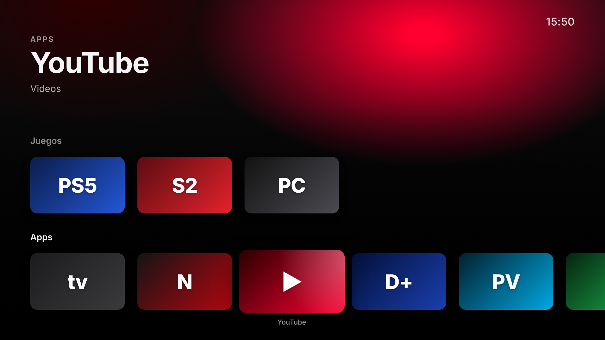
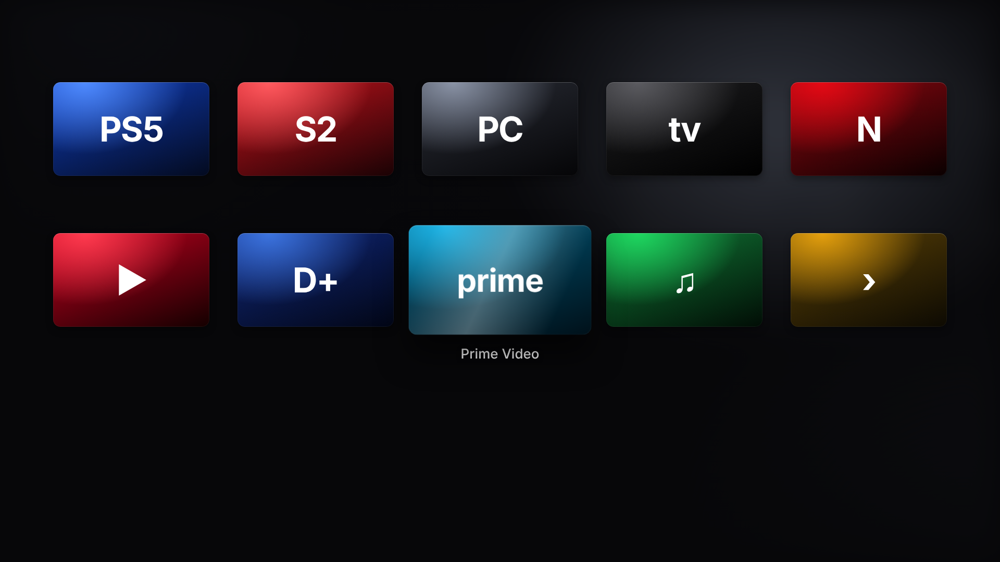

# Hogar: launcher estilo set-top box para Samsung Tizen

App web para Tizen con una estructura inspirada en tvOS:

- **Top shelf a pantalla completa** que cambia con fundido según el ícono enfocado de la fila superior.
- **Fila superior (dock)** con lo más usado: PS5, Switch 2, PC, Apple TV y Netflix.
- **Cuadrícula de apps** debajo. Al bajar, el fondo se desenfoca y oscurece, como en tvOS.
- **Íconos 5:3** con inclinación parallax, brillo especular y el nombre solo bajo el ícono enfocado.
- **Tipografía Helvetica Neue** (con Inter como respaldo; ver "Fuente").
- Sin anuncios ni rastreo.




**Controles:** con OK abres la app o cambias la entrada HDMI. Atrás desde un HDMI vuelve al launcher; Atrás en la cuadrícula sube al dock; en el dock no sale a Smart Hub.

## Qué es y qué no es

- **No** reemplaza Tizen ni modifica el firmware. Se instala como app normal en Modo Desarrollador, que es una función oficial de Samsung. No hay riesgo de dejar inservible el televisor y es reversible: basta con desinstalarla.
- **No** puede borrar Smart Hub. Lo que hace es que casi nunca lo veas (ver "Arranque automático").

## Instalación

1. **Tizen Studio** (en la PC): instala Tizen Studio con el *Package Manager*. Agrega *TV Extensions* y *Samsung Certificate Extension*.
2. **Modo Desarrollador en el televisor:**
   - Abre *Apps* y escribe `1 2 3 4 5` con el control.
   - Activa *Developer Mode* e ingresa la IP local de tu PC.
   - Reinicia el televisor.
3. **Conectar:** en Tizen Studio abre *Device Manager → Remote Device Manager* y agrega la IP del televisor (también funciona `sdb connect <IP-TV>`).
4. **Certificado:**
   - Abre *Tools → Certificate Manager* y crea un certificado **Samsung** (no Tizen) con tu cuenta Samsung.
   - Al crearlo, se registra el DUID del televisor conectado.
5. **Instalar:**
   - Importa esta carpeta como proyecto: *File → Import → Tizen → Tizen Project* (o crea un proyecto *TV Web Basic* y copia estos archivos).
   - Haz clic derecho en el proyecto → *Run As → Tizen Web Application*.
   - Por CLI:
     ```
     tizen package -t wgt -s <perfil-certificado> -- .
     tizen install -n Hogar.wgt -t <nombre-dispositivo>
     ```

## Arranque automático (para no ver Smart Hub)

En *Ajustes → General → Funciones inteligentes*, activa **"Autoejecutar última app"**. Si Hogar es lo último que usaste, el televisor arranca directamente en Hogar.

## Fuente

Helvetica Neue es comercial (Linotype) y no se incluye. Si tienes licencia, copia `HelveticaNeue-Regular.otf`, `HelveticaNeue-Medium.otf` y `HelveticaNeue-Bold.otf` en `fonts/` y la app la usa automáticamente. Si no, usa **Inter** (incluida, licencia OFL, ver `fonts/LICENSE-Inter.txt`).

## Imágenes propias (para un look más cercano a tvOS)

tvOS se ve como se ve, sobre todo, por su arte: carátulas y fondos a pantalla completa. Para uso personal puedes agregar las tuyas:

- **Logos:** `img/logos/<id>.png`. Se detectan solos, sin tocar código: un PNG transparente (de preferencia blanco) se coloca centrado sobre el color del ícono y como marca de agua en el top shelf. Mira `img/logos/LEEME.md` para los nombres de archivo.
- **Fondos:** `img/shelf/<id>.jpg` de 1920×1080 para el top shelf (arte de un juego, foto de tu setup, etc.). En `js/apps.js`, agrega `shelf: "img/shelf/ps5.jpg"` a la ficha.
- **Ícono completo:** `img/icons/<id>.png` de 400×240, con el fondo incluido. En `js/apps.js`, agrega `icon: "img/icons/netflix.png"` a la ficha.

Si no hay imagen, se usan el texto y un degradado con el color de la ficha.

Estas carpetas están en `.gitignore`: los logos y el arte de marcas se quedan en tu computadora y no se suben a GitHub.

## Personalizar

Edita `js/apps.js`. Mueve fichas entre `dock` (fila superior) y `grid`.

- **Puerto HDMI:** cambia `port` para que coincida con donde conectaste cada consola.
- **Apps:** cambia los `appId`. Los ID incluidos son los que publica la comunidad y pueden variar según la región o el firmware. Para ver los de tu televisor, con `sdb` conectado:
  ```
  sdb shell 0 vd_applist
  ```
  También puedes consultar las listas de IDs de Samsung de la integración SmartThings de Home Assistant.

## Notas para juegos

- El cambio a HDMI usa la API `tizen.tvwindow`, que muestra la entrada en pantalla completa por encima de la app. Comprueba en tu televisor que el **Modo Juego / ALLM y VRR** se activen así (el menú de información del juego lo muestra).
- Si no se activan, o notas latencia, usa el cambio de entrada nativo: encender la consola cambia la entrada sola gracias a HDMI-CEC/Anynet+, o usa el botón de fuente del control. Así el televisor maneja la señal directamente.
- Configura el ícono de cada entrada en *Fuentes → Editar* (PC = "PC" para tener 4:4:4) y activa *Input Signal Plus* en esos puertos.
